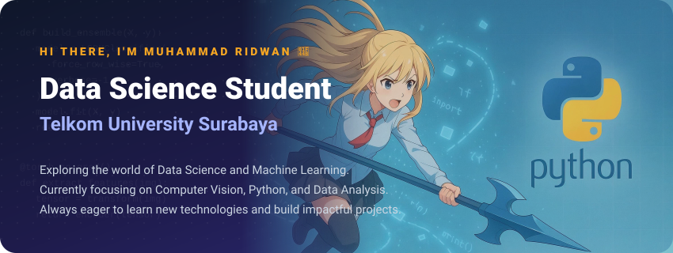

  <!-- Pastikan Anda sudah menjalankan generate_banner.py untuk membuat banner.svg -->
  

  
  
    
  <!-- Core ML & Frameworks -->
  
  
  
  
  
    
  <!-- Computer Vision & Computation -->
  
  
  
    
  <!-- Data Science & Gradient Boosting -->
  
  
  
  
  
    
  <!-- Data Manipulation & Platform -->
  
  
  
  

 

  

 

  <!-- GitHub Stats disesuaikan dengan warna tema gelap Anda -->
  
  

